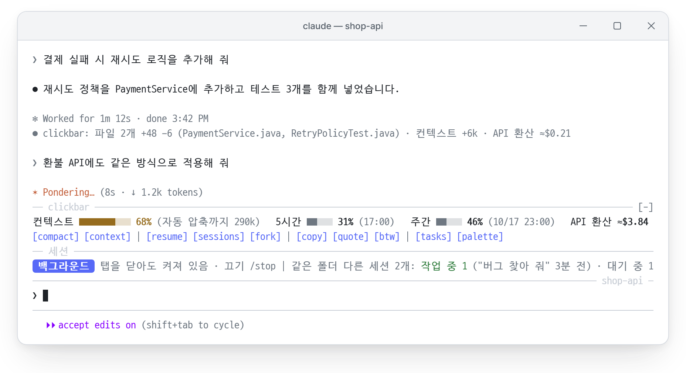
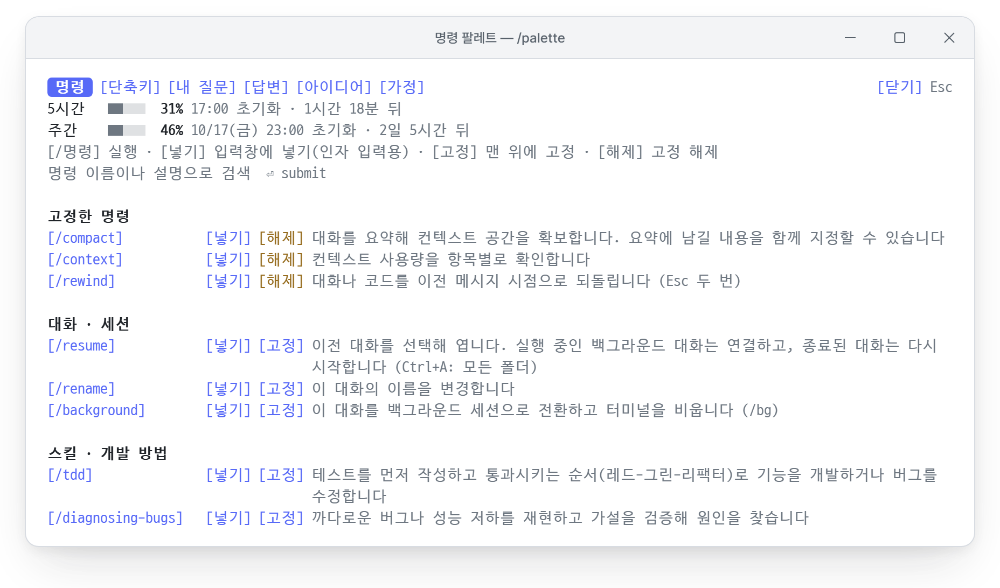
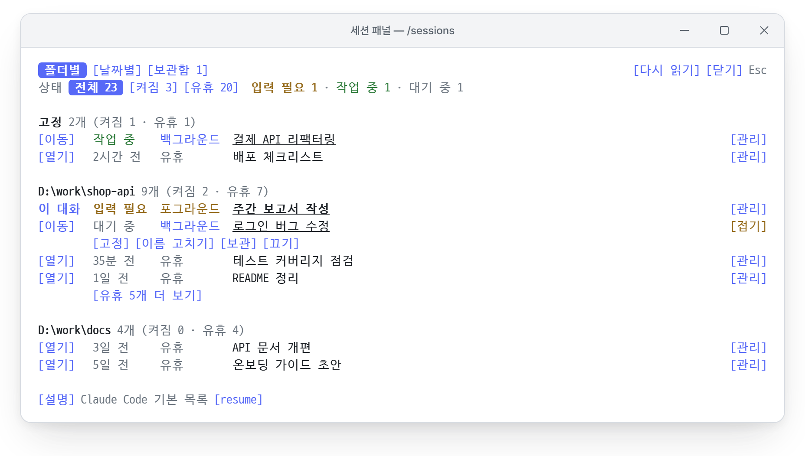

<div align="center">

# mulgogi-mods

**Claude Code를 더 빠르고 편하게 쓰는 한국어 mod 모음**

Claude Code에 입력창 위 대시보드, 명령 팔레트, 세션 관리 패널을 추가합니다.

[](https://code.claude.com/docs/en/plugins/mods/overview)
[](#구성)
[](#요구-사항과-지원-환경)
[](LICENSE)

<picture>
  <source media="(prefers-color-scheme: dark)" srcset="docs/images/hero-dark.png">
  
</picture>

<sub>화면 예시입니다. 대화·폴더 이름은 가상의 예시입니다.</sub>

</div>

## 구성

| mod | 한 줄 요약 | 명령 |
| :- | :- | :- |
| **[clickbar](#clickbar)** | 입력창 위에 컨텍스트·사용량 현황과 주요 명령 버튼을 표시하고, 명령·스킬·단축키·대화 기록을 한곳에서 검색해 실행하는 팔레트를 제공합니다 | `/palette` `/idea` `/tips` `/assumptions` |
| **[session-tracker](#session-tracker)** | 실행 중인 세션의 종류와 상태를 입력창 위에 표시하고, 이 PC의 모든 대화를 폴더·날짜별로 관리합니다 | `/sessions` `/sessions-here` |

## 설치

Claude Code **v2.1.299 이상**이 필요합니다. 터미널에서 다음 명령을 실행합니다.

```bash
claude plugin marketplace add SJvaca30/mulgogi-mods
claude plugin install clickbar@mulgogi-mods
claude plugin install session-tracker@mulgogi-mods
```

필요한 mod만 선택해 설치할 수 있습니다. 실행 중인 세션에는 `/reload-plugins`를 입력하면 바로 적용됩니다. `/plugin` 화면 상단에 `2 mods active · clickbar, session-tracker`가 표시되면 설치가 완료된 것입니다.

> [!TIP]
> Claude Code 안에서 명령 한 줄로 설치할 수도 있습니다: `/plugin install clickbar --marketplace SJvaca30/mulgogi-mods`

## clickbar

### 입력창 위 대시보드

- **상태 줄**: 컨텍스트 사용률과 자동 압축까지 남은 양, 5시간·주간 사용 한도와 초기화 시각, API 환산 비용을 한 줄로 표시합니다. 항목마다 이름·막대·비율을 묶어 구분하고, 위험 수준에 가까워지면 막대와 비율의 색이 바뀌며 `[compact now]` 버튼이 나타납니다.
- **버튼 줄**: 자주 쓰는 명령을 용도별로 묶어 배치합니다. 컨텍스트(`[compact]` `[context]`), 대화(`[resume]` `[sessions]` `[fork]`), 답변(`[copy]` `[quote]` `[btw]`), 도구(`[tasks]` `[palette]`) 순서입니다. 화면이 좁으면 일부 버튼이 숨겨지며, 팔레트에서 실행할 수 있습니다.
- **턴 요약**: 턴이 끝날 때마다 변경된 파일과 줄 수, 컨텍스트 증가량, API 환산 비용을 한 줄로 기록합니다. 소요 시간과 완료 시각은 Claude Code의 기본 표시를 그대로 사용합니다.

### 명령 팔레트

<picture>
  <source media="(prefers-color-scheme: dark)" srcset="docs/images/palette-dark.png">
  
</picture>

- 내장 명령과 설치된 스킬을 용도별로 분류하고 한국어 설명을 제공합니다. 자주 쓰는 명령은 `[고정]`으로 맨 위에 고정할 수 있습니다.
- `[/명령]`은 즉시 실행하고, `[넣기]`는 인자를 입력할 수 있도록 입력창에 명령만 넣습니다.
- 탭 구성: **명령**, **단축키**(OS별 키 표기), **내 질문**(보낸 질문으로 이동·재입력), **답변**(복사), **아이디어**(`/idea`로 저장한 메모), **가정**(Claude의 가정 검토).
- 머리 줄 아래에 5시간·주간 한도의 초기화 시각과 남은 시간을 표시합니다.
- 명령 이름이나 설명으로 검색할 수 있습니다. 팔레트를 열 때마다 검색어는 초기화됩니다.

### Claude의 가정 확인

Claude가 확인 없이 정한 가정을 `log_assumption` 도구로 기록합니다. 입력창 위 `[assumptions N]` 버튼이나 팔레트의 **가정** 탭에서 맞음·틀림을 선택하면, 틀린 가정만 수정하도록 요청합니다.

## session-tracker

<picture>
  <source media="(prefers-color-scheme: dark)" srcset="docs/images/sessions-dark.png">
  
</picture>

- **세션 줄**: 현재 대화의 종류(백그라운드·포그라운드), 탭을 닫았을 때의 동작, 같은 폴더에서 작업 중인 다른 세션을 입력창 위에 표시합니다.
- **세션 패널**(`/sessions`): 실행 중인 대화와 기록만 남은 대화(유휴)를 폴더별·날짜별로 조회하고, 상태(켜짐·유휴)로 필터링합니다. 필터 버튼에는 해당 대화 수가 함께 표시됩니다. 줄 끝 `[관리]`에서 고정·이름 변경·보관·종료를 할 수 있으며, Claude가 답변하는 중에도 바로 열립니다.
- **Orca 연동**: Orca에서는 `[이동]`으로 해당 세션의 탭으로 전환하고, `[열기]`로 종료된 대화를 새 탭에서 다시 엽니다. 일반 터미널에서는 `[여기서 열기]`(`/resume <id>`)와 `[명령 복사]`를 제공합니다.
- **작업 겹침 방지**: 같은 폴더의 다른 세션이 작업 중이면 보내는 질문에 안내 문구를 추가해, 같은 파일을 동시에 수정하지 않도록 합니다.

명령 팔레트와 세션 패널은 머리 줄 구성이 같습니다. 왼쪽에 탭(선택한 탭은 색을 채워 표시), 오른쪽 끝에 `[닫기]`가 있고 `Esc`로도 닫을 수 있습니다.

## 요구 사항과 지원 환경

| 항목 | 내용 |
| :- | :- |
| Claude Code | v2.1.299 이상. mod 기능은 v2.1.287부터 제공되지만, 2.1.296 이하에서는 clickbar의 입력창 위 표시가 나타나지 않는 것을 확인했습니다 |
| 테스트 환경 | Windows 11(Claude Code 2.1.299·2.1.300, Orca 터미널), macOS(자동 테스트와 Orca 터미널). Linux와 데스크톱 앱의 Code 탭은 테스트하지 않았습니다 |
| 선택 사항 | **Orca**: 탭 전환·새 탭 열기·다른 세션 이름 변경 / **PowerShell 7**(`pwsh`): 종료된 대화의 제목 표시(없으면 첫 질문을 표시합니다) |
| 표시되지 않는 환경 | VS Code 확장의 채팅 창, `claude -p`(공식 문서 기준) |

<details>
<summary>macOS 안내</summary>

[단축키] 탭은 macOS에서 Option 키(`Option+P` 등)와 이미지 붙여넣기 `Ctrl+V`로 표시합니다. `Option+P`를 눌렀을 때 `π`가 입력되면, 터미널에서 Option을 Alt로 전달하도록 설정합니다(Orca: 설정 → Terminal → Option as Alt).

</details>

<details>
<summary>Orca가 없는 일반 터미널</summary>

`[이동]`·`[열기]`를 누르면 해당 줄 아래에 `[여기서 열기]`와 `[명령 복사]`가 표시됩니다. `[여기서 열기]`는 내장 `/resume <id>`로 현재 터미널에서 대화를 엽니다. 실행 중인 백그라운드 세션이면 현재 대화를 백그라운드로 전환하고 해당 세션에 연결합니다(Claude Code v2.1.285 이상, `←`로 돌아옵니다). 다른 폴더의 종료된 대화는 `[명령 복사]`만 제공합니다. 다른 창에서 실행 중인 대화형 세션은 "다른 창"으로만 표시합니다. 현재 터미널에서 열면 두 터미널의 메시지가 하나의 기록에 섞이기 때문입니다.

</details>

## Claude에게 영향을 주는 기능

| 기능 | 동작 | 끄는 방법 |
| :- | :- | :- |
| 가정 기록(clickbar) | Claude에게 `log_assumption` 도구를 제공합니다 | `/assumptions off` |
| 명령 추천(clickbar) | 질문에 맞는 내장 명령을 한 번씩 추천합니다. 질문 내용은 변경하지 않습니다 | `/tips off` |
| 작업 겹침 안내(session-tracker) | 같은 폴더의 다른 세션이 작업 중이면 질문에 안내 문구 한 줄을 추가합니다 | `/sessions-here off` |
| 이름 변경 대리 입력(session-tracker) | 다른 세션의 이름을 변경하면 해당 세션의 Orca 탭에 `/rename 새 이름`을 입력합니다. 승인 대기 중이 아니고 입력창이 비어 있을 때만 입력합니다 | 사용하지 않으면 동작하지 않습니다 |

`[btw]`, 아이디어 탭의 `[보내기]`, 가정 탭의 `[틀린 가정 수정 요청]`은 누르면 Claude에게 질문을 전송합니다. 누르지 않으면 아무것도 전송하지 않습니다.

## 데이터와 보안

- 네트워크 요청을 하지 않으며, mod가 스스로 모델을 호출하지 않습니다.
- 설정·고정 목록·아이디어는 `~/.claude/plugins/store/`에, 세션 상태는 `~/.claude/mods-state/session-tracker/`에 저장합니다. 모두 이 PC에만 저장됩니다.
- mod는 사용자 권한으로 실행되는 코드입니다. 설치 전에 저장소를 내려받아 `claude plugin validate ./clickbar`를 실행하면, mod가 사용하는 이벤트와 기능 목록을 확인할 수 있습니다.

## 자주 묻는 질문

<details>
<summary>팔레트의 한국어 설명이 스킬의 실제 설명을 변경하나요?</summary>

아닙니다. 팔레트 화면에만 표시됩니다. Claude가 스킬을 선택할 때 참고하는 SKILL.md의 설명은 변경되지 않습니다. `/` 메뉴의 한국어 설명도 Claude Code 내장 명령의 표시 문구에만 적용됩니다.

</details>

<details>
<summary>다른 사람이 설치해도 같은 명령·스킬 목록이 표시되나요?</summary>

아닙니다. 팔레트는 해당 PC에 설치된 명령과 스킬만 표시합니다. 한국어 설명이 준비된 스킬은 용도별 분류에, 나머지는 "그 밖의 명령"에 원래 설명으로 표시됩니다.

</details>

<details>
<summary>[quote]는 어떤 기능인가요?</summary>

마우스로 선택한 글의 각 줄 앞에 `> `를 붙여 입력창에 넣습니다. Markdown 인용 표시이므로 Claude는 이 부분을 인용문으로 인식합니다. 그 아래에 질문을 이어서 작성하면 됩니다.

</details>

<details>
<summary>입력창 위 표시가 나타나지 않습니다</summary>

`claude --version`이 2.1.299 이상인지 확인합니다. 오래 실행 중인 백그라운드 세션은 시작 시점의 버전으로 계속 실행되므로, `claude stop <id>`로 종료한 뒤 `claude attach <id>`로 다시 엽니다. 회사 계정은 관리자가 사용자 설치 mod를 차단했을 수 있습니다.

</details>

## 업데이트·삭제

```bash
claude plugin marketplace update mulgogi-mods    # 마켓 목록 갱신
claude plugin update clickbar@mulgogi-mods        # mod별 업데이트
claude plugin uninstall clickbar@mulgogi-mods     # 삭제
```

자동 업데이트는 기본적으로 꺼져 있습니다. `/plugin` → Marketplaces → `mulgogi-mods` → Enable auto-update에서 켤 수 있습니다. 업데이트 후에는 `/reload-plugins`를 입력하거나 세션을 다시 시작합니다.

GitHub SSH 키가 없는 PC에서 Claude Code 안의 설치·업데이트가 실패하면, 환경 변수 `CLAUDE_CODE_PLUGIN_PREFER_HTTPS=1`을 설정한 뒤 다시 시도합니다.

## 화면 예시 그림

`docs/make_images.py`가 터미널 화면을 HTML로 다시 그려 헤드리스 Edge(또는 Chrome)로 PNG를 만듭니다. 글꼴은 [D2Coding](https://github.com/naver/d2codingfont)(OFL 1.1)을 씁니다. 팔레트 설명은 `clickbar/hooks/catalog.ts`에서 읽으므로, 설명을 바꾼 뒤 다시 실행하면 그림에도 반영됩니다.

## 라이선스

[MIT](LICENSE)
