<div align="center">

# mulgogi-mods

**Claude Code를 더 빠르고 편하게 쓰는 한국어 mod 모음**

입력창 위 대시보드, 명령 팔레트, 세션 관리 패널을 Claude Code 안에 더합니다.

[](https://code.claude.com/docs/en/plugins/mods/overview)
[](#구성)
[](#요구-사항과-지원-환경)
[](LICENSE)

<picture>
  <source media="(prefers-color-scheme: dark)" srcset="docs/images/hero-dark.svg">
  
</picture>

<sub>화면 예시입니다. 대화와 폴더 이름은 예시로 바꿨습니다.</sub>

</div>

## 구성

| mod | 한 줄 요약 | 명령 |
| :- | :- | :- |
| **[clickbar](#clickbar)** | 입력창 위에 컨텍스트·사용량 현황과 주요 명령 버튼을 두고, 명령·스킬·단축키·대화 기록을 한곳에서 찾아 실행하는 팔레트를 제공합니다 | `/palette` `/idea` `/tips` `/assumptions` |
| **[session-tracker](#session-tracker)** | 실행 중인 세션의 종류와 상태를 입력창 위에 표시하고, 이 PC의 모든 대화를 폴더·날짜별로 관리합니다 | `/sessions` `/sessions-here` |

## 설치

Claude Code **v2.1.299 이상**에서 셸에 입력합니다.

```bash
claude plugin marketplace add SJvaca30/mulgogi-mods
claude plugin install clickbar@mulgogi-mods
claude plugin install session-tracker@mulgogi-mods
```

필요한 mod만 골라 설치해도 됩니다. 열려 있는 세션에서는 `/reload-plugins`를 입력하면 바로 적용됩니다. `/plugin` 위쪽에 `2 mods active · clickbar, session-tracker`가 보이면 설치가 끝난 것입니다.

> [!TIP]
> Claude Code 안에서 한 줄로 설치할 수도 있습니다: `/plugin install clickbar --marketplace SJvaca30/mulgogi-mods`

## clickbar

### 입력창 위 대시보드

- **상태 줄**: 컨텍스트 사용률과 자동 압축까지 남은 양, 5시간·주간 사용 한도와 초기화 시각, API 환산 비용을 한 줄에 보여 줍니다. 위험 수준에 가까워지면 색이 바뀌고 `[compact now]` 버튼이 나타납니다.
- **버튼 줄**: 자주 쓰는 명령을 용도별로 묶었습니다. 컨텍스트(`[compact]` `[context]`), 대화 찾기(`[resume]` `[sessions]` `[fork]`), 답변 다루기(`[copy]` `[quote]` `[btw]`), 도구(`[tasks]` `[palette]`) 순서입니다. 화면이 좁으면 일부 버튼은 팔레트로 옮겨 갑니다.
- **턴 요약**: 턴이 끝날 때마다 바뀐 파일과 줄 수, 컨텍스트 증가량, API 환산 비용을 한 줄로 남깁니다. 걸린 시간과 끝난 시각은 Claude Code가 보여 주는 줄에 맡깁니다.

### 명령 팔레트

<picture>
  <source media="(prefers-color-scheme: dark)" srcset="docs/images/palette-dark.svg">
  
</picture>

- 내장 명령과 설치한 스킬을 용도별로 묶고 한국어 설명을 붙였습니다. 자주 쓰는 명령은 `[고정]`으로 맨 위에 둡니다.
- `[/명령]`은 바로 실행하고, `[넣기]`는 인자를 붙일 수 있게 입력창에 넣기만 합니다.
- 탭 구성: **단축키**(OS에 맞는 키 표기), **내 질문**(보낸 질문으로 이동하거나 다시 넣기), **답변**(복사), **보관함**(`/idea`로 모은 아이디어), **짐작**(Claude의 가정 검토).
- 명령 이름이나 설명으로 검색합니다. 팔레트를 열 때마다 검색칸은 비워집니다.

### Claude의 가정 확인

Claude가 확인 없이 정한 가정을 `log_assumption` 도구로 기록하게 합니다. 입력창 위 `[assumptions N]`이나 팔레트의 **짐작** 탭에서 맞음·틀림을 고르면, 틀린 것만 바로잡도록 요청을 보냅니다.

## session-tracker

<picture>
  <source media="(prefers-color-scheme: dark)" srcset="docs/images/sessions-dark.svg">
  
</picture>

- **세션 줄**: 이 대화가 백그라운드인지 포그라운드인지, 탭을 닫으면 어떻게 되는지, 같은 폴더에서 작업 중인 다른 세션이 있는지를 입력창 위에 보여 줍니다.
- **세션 패널**(`/sessions`): 켜진 대화와 기록만 남은 대화(유휴)를 폴더별·날짜별로 보고, 켜짐·유휴로 거릅니다. 줄 끝 `[관리]`에서 고정·이름 고치기·보관·끄기를 합니다. 답변 중에도 바로 열립니다.
- **Orca 연동**: Orca 안에서는 `[이동]`으로 그 세션의 탭으로 옮기고, `[열기]`로 꺼진 대화를 새 탭에서 다시 엽니다. 일반 터미널에서는 `[여기서 열기]`(`/resume <id>`)와 `[명령 복사]`를 제공합니다.
- **겹침 방지**: 같은 폴더의 다른 세션이 작업 중이면, 보내는 질문에 그 사실을 알리는 안내를 붙여 같은 파일을 동시에 고치지 않게 합니다.

## 요구 사항과 지원 환경

| 항목 | 내용 |
| :- | :- |
| Claude Code | v2.1.299 이상. mod 기능은 v2.1.287부터지만, 2.1.296 이하에서는 clickbar의 입력창 위 줄이 그려지지 않는 것을 확인했습니다 |
| 시험한 환경 | Windows 11(Claude Code 2.1.299·2.1.300, Orca 안의 터미널), macOS(자동 테스트와 Orca 안의 터미널). Linux와 데스크톱 앱 Code 탭은 시험하지 않았습니다 |
| 선택 사항 | **Orca**: 탭 이동·새 탭 열기·다른 세션 이름 바꾸기 / **PowerShell 7**(`pwsh`): 꺼진 대화의 제목 표시(없으면 첫 질문을 보여 줍니다) |
| 화면이 보이지 않는 곳 | VS Code 확장의 채팅 창, `claude -p`(공식 문서 기준) |

<details>
<summary>macOS 안내</summary>

[단축키] 탭은 macOS에서 Option 키(`Option+P` 등)와 이미지 붙여넣기 `Ctrl+V`로 표시합니다. `Option+P`를 눌렀을 때 `π`가 입력되면, 터미널이 Option을 Alt로 넘기도록 설정합니다(Orca: 설정 → Terminal → Option as Alt).

</details>

<details>
<summary>Orca가 없는 일반 터미널</summary>

`[이동]`·`[열기]`를 누르면 그 줄 아래에 `[여기서 열기]`와 `[명령 복사]`가 펼쳐집니다. `[여기서 열기]`는 내장 `/resume <id>`로 이 터미널에서 엽니다. 켜진 백그라운드 세션이면 지금 대화를 백그라운드로 보내고 그 세션에 연결합니다(Claude Code v2.1.285 이상, `←`로 돌아옵니다). 다른 폴더의 꺼진 대화는 `[명령 복사]`만 제공합니다. 다른 창에서 켜진 대화형 세션은 "다른 창"으로만 표시합니다. 여기서 열면 두 터미널의 메시지가 한 기록에 섞이기 때문입니다.

</details>

## Claude에게 영향을 주는 기능

| 기능 | 하는 일 | 끄는 법 |
| :- | :- | :- |
| 가정 기록(clickbar) | Claude에게 `log_assumption` 도구를 제공합니다 | `/assumptions off` |
| 명령 추천(clickbar) | 질문에 맞는 내장 명령을 한 번씩 알려 줍니다. 질문은 바꾸지 않습니다 | `/tips off` |
| 겹침 안내(session-tracker) | 같은 폴더의 다른 세션이 작업 중이면 질문에 안내 한 줄을 붙입니다 | `/sessions-here off` |
| 이름 대신 입력(session-tracker) | 다른 세션의 이름을 고치면 그 세션의 Orca 탭에 `/rename 새 이름`을 입력합니다. 승인을 기다리지 않고 입력창이 비어 있을 때만 합니다 | 쓰지 않으면 동작하지 않습니다 |

`[btw]`, 보관함의 `[Send]`, 짐작 탭의 `[틀린 짐작 고쳐 달라고 보내기]`는 누르면 질문을 보내 Claude가 답하게 합니다. 누르지 않으면 질문을 보내지 않습니다.

## 데이터와 보안

- 네트워크 요청을 하지 않으며, mod가 스스로 모델을 호출하지 않습니다.
- 설정·고정·보관함은 `~/.claude/plugins/store/`에, 세션 상태는 `~/.claude/mods-state/session-tracker/`에 저장합니다. 모두 이 PC에만 남습니다.
- mod는 사용자 권한으로 실행되는 코드입니다. 설치 전에 이 저장소를 내려받아 `claude plugin validate ./clickbar`처럼 입력하면, mod가 받는 이벤트와 호출하는 기능을 목록으로 확인할 수 있습니다.

## 자주 묻는 질문

<details>
<summary>팔레트의 한국어 설명이 스킬의 실제 설명을 바꾸나요?</summary>

아닙니다. 팔레트 화면에만 보입니다. Claude가 스킬을 고를 때 읽는 SKILL.md의 설명은 그대로입니다. `/` 메뉴의 한국어 설명도 Claude Code 내장 명령의 표시 글에만 적용됩니다.

</details>

<details>
<summary>다른 사람이 설치해도 같은 명령·스킬 목록이 보이나요?</summary>

아닙니다. 팔레트는 그 PC에 설치된 명령과 스킬만 보여 줍니다. 한국어 설명을 준비해 둔 스킬은 용도별 묶음에 나오고, 그 밖의 것은 "그 밖의 명령"에 원래 설명으로 나옵니다.

</details>

<details>
<summary>[quote]는 무엇을 하나요?</summary>

마우스로 선택한 글의 줄마다 `> `를 붙여 입력창에 넣습니다. Markdown 인용 표시라 Claude는 인용한 부분으로 읽습니다. 그 아래에 질문을 이어 쓰면 됩니다.

</details>

<details>
<summary>입력창 위 줄이 보이지 않습니다</summary>

`claude --version`이 2.1.299 이상인지 확인합니다. 오래 켜 둔 백그라운드 세션은 시작할 때의 버전으로 계속 돌기 때문에, `claude stop <id>`로 멈춘 뒤 `claude attach <id>`로 다시 엽니다. 회사 계정이면 관리자가 사용자가 설치한 mod를 막아 두었을 수 있습니다.

</details>

## 업데이트·삭제

```bash
claude plugin marketplace update mulgogi-mods    # 새 목록 받기
claude plugin update clickbar@mulgogi-mods        # mod별 업데이트
claude plugin uninstall clickbar@mulgogi-mods     # 삭제
```

자동 업데이트는 기본으로 꺼져 있습니다. `/plugin` → Marketplaces → `mulgogi-mods` → Enable auto-update로 켭니다. 업데이트한 뒤에는 `/reload-plugins`를 입력하거나 세션을 다시 엽니다.

GitHub SSH 키가 없는 PC에서 Claude Code 안의 설치·업데이트가 실패하면, 환경 변수 `CLAUDE_CODE_PLUGIN_PREFER_HTTPS=1`을 설정한 뒤 다시 시도합니다.

## 라이선스

[MIT](LICENSE)
